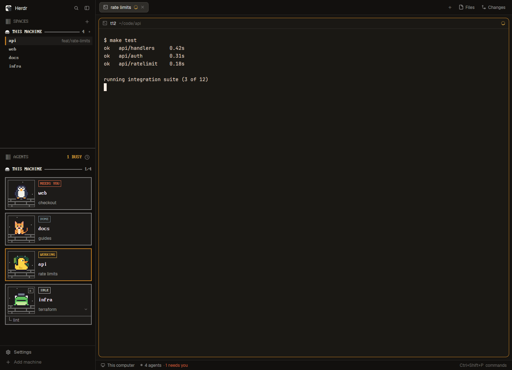

# Pixelherd

A pixel-art sidebar for the [Herdr](https://herdr.dev) desktop app. Your spaces and
agents sit under one header per machine, in a DOS-style pixel font. Each agent gets a
square card with a small pixel scene and an animal of its own: a duck, a frog, a cat or
a penguin. The badge on the card tells you what the agent is doing, and the animal bobs
while it works. The sidebar takes its colors from the Herdr theme you pick, so it
fits light and dark themes alike. Only the animals keep their own colors.



## Before you install

Pixelherd is one layout (`layouts/pixelherd.json`) and two mods
(`mods/pixelherd-spaces`, `mods/pixelherd-agents`). Herdr asks you to know what a mod
does outside its own folder before you add it. These two:

- run `git status` and `git rev-parse` in each space's folder (the folder its first
  terminal is in, else the folder the space was made in), on the machine the space
  lives on, to show its branch and the commits ahead and behind. For a space on
  another machine, these run there, over Herdr's connection to it;
- watch each local space's repo for commits and checkouts;
- run `hc machine ls` every 15 seconds, to show which machines you can reach;
- run `hc machine rm` and then `hc machine add` only when you click Connect on a
  machine that was rebuilt. Those commands connect to that machine.

The mods make no web requests of their own. They copy all of this from Herdr's own
`spaces` mod. [RECIPE.md](RECIPE.md#built-from) lists every command and stored key.

You need the Herdr desktop app. Pixelherd is built from Herdr 0.1.13's own `main`
layout and mods. The pixel font is PxPlus IBM VGA 8x16, which loads from Herdr's own
install (`mods/win98/fonts/`), so the repo does not ship it.

## Install

### Ask your Herdr agent

Paste this line to the coding agent in a Herdr terminal:

```text
Read ~/.config/herdr-app/AGENTS.md, then add this layout: github.com/jzetterman/herdr-pixelherd
```

Herdr's own guide tells the agent how: read every file, tell you what the mods run,
copy them in without overwriting anything of yours, check each mod, and switch to the
layout. If you run Herdr with `HERDR_APP_HOME` set, put that folder in place of
`~/.config/herdr-app`.

### By hand (macOS and Linux)

Read the files first. It's a small repo, and a mod is code that runs in your window.

```sh
git clone https://github.com/jzetterman/herdr-pixelherd.git
cd herdr-pixelherd
HH="${HERDR_APP_HOME:-$HOME/.config/herdr-app}"
```

Make sure no name is taken. This prints nothing when all three are free:

```sh
for p in layouts/pixelherd.json mods/pixelherd-spaces mods/pixelherd-agents; do
  [ -e "$HH/$p" ] && echo "taken: $HH/$p"
done
```

If it prints a line, stop and use the agent line above instead. Herdr's guide has the
agent rename the new files so nothing of yours is overwritten.

Copy the files, check the mods, and switch. The switch runs only if both checks pass:

```sh
mkdir -p "$HH/layouts" "$HH/mods"
cp layouts/pixelherd.json "$HH/layouts/"
cp -R mods/pixelherd-spaces mods/pixelherd-agents "$HH/mods/"
herdr-app check "$HH/mods/pixelherd-spaces" &&
  herdr-app check "$HH/mods/pixelherd-agents" &&
  herdr-app do layout.switch --name pixelherd
```

Herdr loads layouts and mods live, so there is nothing to restart. Leave out
`RECIPE.md`, `preview.png`, `screenshot.png` and `tools/`: Herdr doesn't use them.

### Switch back or remove it

`ctrl-shift-l` cycles through your layouts. Your own layout stays as it was.

To remove Pixelherd, switch to another layout first. If you installed it by hand with
the steps above, delete its files:

```sh
HH="${HERDR_APP_HOME:-$HOME/.config/herdr-app}"
rm -r "$HH/layouts/pixelherd.json" "$HH/mods/pixelherd-spaces" "$HH/mods/pixelherd-agents"
```

If an agent installed it, ask the agent to remove it. When a name was taken, the agent
gave Pixelherd's files new names, and the command above would delete your own files
instead.

## Themes

The sidebar names no colors of its own. It reads the theme you pick in Herdr and works
out each machine's color from it, so a theme change recolors the sidebar at once. The
animals are the exception: they keep their own colors in every theme. The
screenshot uses Piedmont Gold, a custom Omarchy theme, through Herdr's `omarchy`
theme, which follows whatever Omarchy theme you set. RECIPE.md has the details, under "Watch out".

## More

- [RECIPE.md](RECIPE.md) describes the whole layout: every region, size, color and
  click. Herdr's gallery format uses it as the brief to rebuild the layout from scratch.
- [tools/](tools/) holds the checks for anyone changing the code: `node --test tools/` and
  the color and speed checks. RECIPE.md, under "Done when", says what each one needs.

## License

Apache-2.0. See [LICENSE](LICENSE). Pixelherd is built from Herdr's shipped layout and
mods, which are also Apache-2.0. The PxPlus IBM VGA 8x16 font is by VileR
([int10h.org](https://int10h.org/oldschool-pc-fonts/)), under CC BY-SA 4.0. Pixelherd
uses Herdr's copy and does not ship it.
