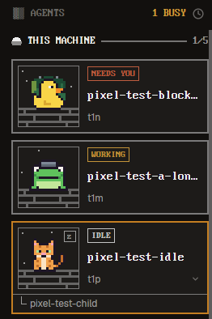

# Pixelherd

Herdr's own window with a pixel-art sidebar. Spaces and agents sit under one header per
machine, in a DOS-style pixel font, and each agent gets a square card with a small
pixel scene and an animal of its own. Every color comes from the Herdr theme you have
picked, so the sidebar fits dark themes, light themes and Omarchy's theme alike.

## What you see

Left to right: a sidebar 268 px wide, then Herdr's usual work area.

The sidebar, top to bottom:

- **Brand row** (46 px), Herdr's own: name, search, sidebar toggle.
- **SPACES** (2 shares of the height). A header row 31 px tall: a dithered block
  icon `▓▒`, then "SPACES" in PxPlus IBM VGA 8x16 at 14 px, in the theme's dim
  color, and a `+` on the right.
- **One header per machine**, this computer first as "THIS MACHINE", then each other
  machine by name, upper case. Each row is 26 px: a 13 x 10 px two-tone machine icon,
  the name at 14 px in the machine's label color, a 2 px rule line in the same color,
  fainter, the space count and a `+`. A machine out of reach dims its icon, name and
  rule line to the theme's muted and dim colors and shows its state ("unreachable",
  "needs login").
- **Space rows**, 24 px (22 px for a worktree under its repo), the name at 14 px in
  the machine's label color, fainter. The active row sits on the machine's card fill,
  with a 3 px bar on its left in the theme's accent (brought to 5:1) and its name in the foreground
  color. After a name, only what is unusual: the repo, the branch, and `↑` / `↓`
  counts in the theme's ANSI green and red (`ansi2`, `ansi1`), which some themes make
  gray. A long name leaves the repo and branch about six characters.
- **AGENTS** (3 shares). A header row: the dither icon, "AGENTS", "N BUSY" (in the
  working color when N is above 0) and the sort button.
- **Agents grouped by machine**, under a 28 px header with the same icon, name and
  rule line, ending in `working/total` (13 px) instead of the count and `+`. A
  machine out of reach dims its icon, name and line and says "unavailable".
- **One card per agent**: a square box with a 2 px border in the machine's line color
  (the accent when its pane has focus) on the machine's card fill. On the left a
  76 x 76 px scene: the fill as its sky, two or three 2 px stars, a dock of
  planks and posts, and a 48 px animal standing on it (duck, frog, cat or penguin,
  picked from the agent's address, so it never changes). On the right: a status
  badge in a 1 px box at 12 px, the space name at 16 px (for a `~` space, the
  pane's folder) and the tab below it in the UI font at 12 px ("tab 2" for an
  unnamed tab). Hovered, the border grows stronger, but stays fainter than a
  focused card's.
- **Sub-agents** inside their parent's card, below a 1 px divider: tree lines, the
  name in the UI font at 12 px and a small status mark, 18 px a row. The marks: a
  spinner for working, "!" on a tint of the blocked color, a square ring for idle,
  a square dot for done.
- **Footer** (69 px), Herdr's own: Settings, Add machine.

Everything is square: no rounded rows, cards, badges or boxes.

The colors. The layout names no theme, so it shows yours. Each machine gets one of
six palettes, by its place in the sorted list of machines (this computer first). A
palette's label color is one of the theme's twelve ANSI hues (`ansi1` to `ansi6`,
`ansi9` to `ansi14`), its accent or its foreground, moved in lightness until it reads
at 5:1 on the sidebar. The first three palettes take three of those 14 colors that
sit clearly apart (CIEDE2000 10 or more from each other) and keep as far as they can
from the blocked color. Of those three, this computer's palette takes the one
farthest from the blocked color. A theme with too little variety for three such
colors takes the three that sit farthest apart. The other three palettes take the
remaining colors, farthest from the blocked color first. So a machine's color sits
as far from the NEEDS YOU color as the theme's colors allow, but in a theme with few
distinct hues it can still come close; the badge's word (IDLE or NEEDS YOU) always
tells them apart.
The card fill is
the sidebar color moved a little (up to 10%) toward the label. Lines, counts,
subtitles and the fainter names use the label color with less opacity. Machine
names, the active space's name, card titles and badge words read at 4.5:1 or more
on what they sit on; fainter names (other spaces, subtitles, sub-agents), section
titles, lines, counts and icons at 3:1 or more. Each surface (the sidebar, each
card fill, the sort menu, a raised row) hovers to the theme's hover color drawn
over it, as Herdr's own rows do, made fainter only where a label or the text on it
would drop below its bar. While you drag a space, its row fades to half opacity, as in
Herdr's own list; that fade is the one place the bars don't apply.

Narrow sidebars. Below about 243 px a card drops its scene and its text takes the
whole card. The SPACES and AGENTS headers drop their dither icons together. Machine
headers drop the rule line first. A reconnect error shortens with "…" first; short
of room after that, a state such as "unreachable" or the error shrinks to "!" (the
full text is the tooltip). Connect keeps its word until the name would drop below
six characters, then becomes a small circular-arrow button. Names shorten with "…"
but keep at least six characters. Below 160 px the sidebar becomes Herdr's rail.
SPACES keeps icon-only machine headers over numbered space rows with their status
marks. AGENTS becomes one numbered list of agents with their status marks, with no
headers, and a `»` at the bottom that widens the sidebar again.

## How it behaves

Agent status on a card:

- **Working**: "WORKING" in the theme's working color. The badge pulses (1100 ms) and
  the animal bobs 3 px (700 ms).
- **Blocked**: "NEEDS YOU" in the blocked color, pulsing.
- **Done**: "DONE" in the done color. It turns idle once you look at the agent.
- **Idle**: "IDLE" in the palette's label color, and a boxed "z" in the scene's top
  right.

Only WORKING and NEEDS YOU pulse. Their lowest opacity is the lowest from 0.45 up
that keeps both badges at 3:1 in every palette.

Clicks and keys:

- Click a space to switch to it; right-click for Herdr's space menu; drag a space to
  reorder it within its machine.
- Click a machine header to fold its rows; a folded header shows its count as `N►`.
  A folded agents header also shows the mark of its most urgent agent. The `+` on a
  header makes a space on that machine.
- A machine that was rebuilt shows Connect. Clicking it forgets the old machine and
  pairs again under the same name.
- Click a card to focus its pane. Hover a card for the pin button at its top right;
  it pins or unpins the agent. A pinned card keeps showing the pin, which turns into
  the unpin glyph while you hover the card.
- The fold control under a card's title folds its sub-agents. Click a sub-agent row
  to peek at it.
- The sort button picks Priority or Grouped by space. Cards stay grouped by
  machine either way. Priority puts each machine's most urgent agents first;
  Grouped by space keeps Herdr's agent order (space, tab, pane), so a space's
  agents sit together, with no space headers.
- `agent.next` and `agent.prev` follow the cards top to bottom, across machines.

Theme changes (the picker, settings, or a rewritten theme file) recolor the sidebar
at once, with the rest of the window.

## Built from

The layout, `layouts/pixelherd.json`, is a clone of Herdr 0.1.13's `main`. Its node tree:

- `root` (row, background `canvas`, terminal padding 14 x 12, no title bar)
  - `sidebar` (column, 268 px, from 44 to 480 px, background `chrome`)
    - `brand`: `workspace-chrome`, 46 px
    - `sidebar-lists` (column)
      - `spaces`: `pixelherd-spaces`, weight 2, min 90 px
      - `agents`: `pixelherd-agents`, weight 3, min 90 px
    - `sidebar-footer`: `workspace-chrome` with props `{ "footer": true }`, 69 px
  - `work` (column)
    - `tabs`: `tabs`, 42 px
    - `work-body` (row, padding 8, gap 8): `main` (the active tab, each pane a card
      with radius 10, gap 8 and the `pane` header mod) and `panel` (a stack of `files`
      and `changes`, 368 px, hidden)
    - `status`: `workspace-status`, 28 px

The mods. Each is a clone of a shipped Herdr 0.1.13 mod and takes no props of its own.

- `mods/pixelherd-spaces/`, from `spaces`: the SPACES list.
- `mods/pixelherd-agents/`, from `agents`: the AGENTS list, its cards, and the sort menu,
  which it opens as its own popup with props `{ "sortMenu": true }`.
- Both carry the same two modules, byte for byte. `colors.js` is the one color block:
  it reads `theme()` and returns every color the mods draw. `look.js` holds the pixel
  font name, the machine icon, the dither icon, the palette order, the sidebar's
  width and the width budget.
- Each `main.js` names its own folder once, as `SELF = "mods/<name>/"`. Sprite paths,
  the reconnect icon and the sort menu's overlay all derive from it.

The shipped mods it relies on: `workspace-chrome` (the brand row, the footer, and the
icons `plus`, `branch`, `check`, `spinner`, `pin`, `pin-off`, `clock`, `layers`,
`chevron-down` and `chevron-right`), `menu` (the space right-click menu), `tabs`,
`pane`, `files`, `changes` and `workspace-status`. The font is
`mods/win98/fonts/PxPlus_IBM_VGA_8x16.ttf`, from Herdr's own install.

The `herdr` functions it calls: `spaces`, `machines`, `agents`, `terminals`, `panes`,
`focused`, `layout`, `window`, `theme`, `props`, `shared`, `setShared`,
`setAgentOrder`, `openOverlay`, `closeOverlay`, `run`, `exec`, `hc` and
`watchFolder`. The commands it runs: `space.select`, `space.new`, `space.move`,
`pane.focus`, `terminal.pin`, `terminal.peek` and `layout.resize`.

Programs and files. All of these come from Herdr's shipped `spaces` mod; the new code
adds no programs, no files and no network access:

- `git status` (`--no-optional-locks -c core.fsmonitor=false status --porcelain=v2
  --branch`), `git rev-parse --show-toplevel` and `git rev-parse --path-format=absolute
  --git-common-dir`, in the folder each space's first terminal is in (else the
  space's folder), on that space's machine.
- `watchFolder` on each local space's repo, to see commits and checkouts.
- `hc machine ls --json`, every 15 seconds.
- The reconnect flow, only when you click Connect on a rebuilt machine:
  `hc machine rm <name>`, then `hc machine add <target> --name <name>` (`--via
  <target>` instead for a machine reached that way, plus `--session` or `--temp` as
  the machine had them). These connect to the
  other machine. If the add fails, the machine stays removed until you try again.

State. Per-mod `localStorage`: `machines.folded` and `machines.reconnecting`
(pixelherd-spaces), `pins` and `changed` (pixelherd-agents). Shared keys, also used by
Herdr's own mods: `sidebar.width`, `sidebar.collapsed`, `agents.sort` and
`space.colors`. The sidebar's width lives in the layout's saved clicks
(`layout.resize`).

The art. The four animals are 16 x 16 pixel SVGs in `mods/pixelherd-agents/sprites/`,
drawn at 48 px. They keep their own colors in every theme. The reconnect icon is
`mods/pixelherd-spaces/reconnect.svg`, tinted with the Connect control's color
(muted, or the blocked color after a failed try).

Credits. Built from Herdr's shipped mods and layout (Apache-2.0). The PxPlus IBM VGA
8x16 font is by VileR, int10h.org, under CC BY-SA 4.0; this package uses Herdr's copy
and does not ship it. The package is Apache-2.0; see `LICENSE`.

## Watch out

- **The font is Herdr's.** It loads from the shipped `mods/win98/fonts/`. If a Herdr
  update drops or moves Herdr 98, the pixel text falls back to another font. The fix
  is to copy the font and its license into a mod's `fonts/` folder.
- **Shipped mods change.** The layout keeps `main`'s blocks (`workspace-chrome`,
  `tabs`, `pane`, `files`, `changes`, `workspace-status`) and the mods draw
  `workspace-chrome` icons and open `menu`. An update that renames or drops any of
  these breaks that part.
- **Shared keys are shared.** `sidebar.width`, `sidebar.collapsed`, `agents.sort` and
  `space.colors` are Herdr's own keys too. If Herdr changes what they mean, the
  sidebar follows the change.
- **The mods are clones of Herdr 0.1.13.** Herdr's later fixes to `spaces`, `agents`
  and `main` don't reach them.
- **After a rename.** If a name is taken, Herdr's install renames the layout file, the
  `mod` names in it and each mod's `mods/<name>/` paths. That covers every
  self-reference (the `SELF` lines), so nothing needs a hand fix. The names in
  `LICENSE` stay the original ones.
- **Widths are estimated.** `look.js` adds up each part's width (PxPlus glyphs at half
  their size, UI text at 0.6 of it) instead of measuring. Where a UI-font name keeps
  its six characters, each counts 1 em, so the floor holds for any ASCII text in the
  Geist that Herdr 0.1.13 embeds. Seven Geist glyphs (‰ № Љ Њ Œ ↔ Щ) and CJK or
  emoji from fallback fonts are wider, so a name made of them can show fewer than six
  characters. The scrollbar counts as 0 px: in Herdr 0.1.13 it
  draws over the list's right padding. A different UI font, or a Herdr whose
  scrollbar takes width, can make a header shorten earlier or later than it should.
- **Lines read at 3:1.** On themes whose `border` is faint, the sidebar's lines and
  the AGENTS divider are brighter than Herdr's own dividers. That is on purpose.
- **Omarchy.** With Omarchy's Herdr integration (Omarchy PR #17118),
  `omarchy-theme-set-herdr-app --activate` keeps a Herdr theme named `omarchy` in
  step with your Omarchy theme. It picks the theme for the layout on screen only, so
  run it while `pixelherd` shows, or pick `omarchy` in the theme picker on `pixelherd`.
- **Done turns idle when seen.** A done agent turns idle as soon as any Herdr window
  shows it.

## Done when

- `herdr-app check mods/pixelherd-spaces` and `herdr-app check mods/pixelherd-agents`
  pass, and `herdr-app do layout.switch --name pixelherd` shows the sidebar with no
  errors in `herdr-app status`.
- With a working, a blocked and an idle agent, each card shows its badge and animal;
  the idle card shows the "z"; three shots about 230 ms apart differ in the working
  card's badge and scene.
- An agent with a sub-agent shows a "└ name" row inside its card.
- Picking another theme recolors the sidebar in the next shot, and a light theme
  gives a light sidebar.
- At a 160 px sidebar, both badges show "WORKING" and "NEEDS YOU" in full, cards show
  no scene, and no name runs past an edge. At 44 px the rail shows.
- `agent.next`, run once per agent, focuses the cards top to bottom.
- `node --test tools/`, `node tools/check-colors.mjs` on `tools/fixtures/themes.json` and
  on `tools/fixtures/captures.json` (the 30 test-set themes as Herdr captured them), and
  `bash tools/search.sh` pass. The tools need Node 22.15 or newer (23.5 or newer on
  the 23 line), for `module.registerHooks()`, and Node's built-ins only. (The
  `tools/` folder is for building and checking; the install leaves it out.)
- `tools/search.sh` (and so `node --test tools/`) needs bash 4 or newer and GNU
  `grep` with `-P`; stock macOS has neither, so install them first. It checks each
  host call, command, store key, import and color against fixed lists, as the code
  writes them, and pins line by line the reconnect code that builds `hc`'s
  arguments. It does not follow what other variables hold. It is the author's
  regression check, not a guard against a hostile fork: code that builds a name at
  run time (`cx["open" + "_url"]`) can beat any pattern scan, and `node --test tools/`
  runs the mods' code in Node with no sandbox. The real guard is Herdr's install
  step: read every file before you install it or run its tools.
- `node tools/bench-qjs.mjs` times `colors()` under QuickJS, the engine Herdr runs
  mods in, on `tools/fixtures/themes.json`, `captures.json` and `stress.json` (made-up
  themes that make the color searches work hardest). It passes when every theme takes
  25 ms or less (the median of five runs) and QuickJS returns exactly what Node does.
  It needs `qjs` (QuickJS or QuickJS-ng) on PATH. Timing depends on the machine. On the
  author's, Herdr cut off a render at about 49 ms (47 ms passed), so the bar is half
  that; real themes take 10 ms or less there, made-up ones up to about 20 ms. Herdr's
  own limit is not documented, and a slower machine has less headroom and can miss the
  bar with nothing wrong. So it is not part of
  `node --test tools/`; that suite counts the work instead
  (`tools/colors-output.test.mjs`).
